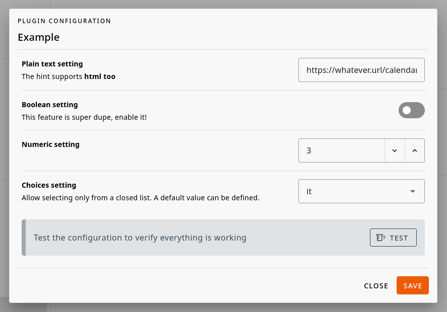

# Plugins
Plugins allow you to extend Gancio features and integrate it with other services.
With plugins you can:
- react to events related actions (create, update, delete) for example to send a notification to another service.
- expose your own API endpoints to be used by other services or your own frontend.
- create your own database tables and use them to store custom data.
- add your own settings to the admin panel and use them in your plugin
- expose a CLI command to be used in the terminal

::: warning
The v2 of Gancio introduced a new plugin system that is not compatible with the old one, so if you have an old plugin you will need to update it (the basic syntax is pretty much the same).

The documentation for v1 can be found at [Plugins - Gancio](/v1/dev/plugins).
:::


## Basics
To start developing a plugin you can copy the [example plugin](https://framagit.org/les/gancio/-/tree/main/plugins/example?ref_type=heads) and modify it as you need.

A plugin is essentially an `index.ts` file inside its own path in `./plugins`, e.g. `./plugins/my-example-plugin/index.ts`

```typescript
import type { GancioContext, GancioPlugin } from '../server/services/plugins'
export default ({ log, db, publicSettings, services }: GancioContext): GancioPlugin => ({
  manifest: {
    name: 'An example plugin',
    author: 'lesion',
    url: 'https://framagit.org/les/gancio',
    description: 'An example plugin to show how to create a plugin for Gancio',
  }
})
```

Plugins should be inside `./plugins` directory but you can specify another location using [`plugins_path`](../install/configuration#plugins-path) configuration.

## Plugin details
A plugins **MUST** declare a `manifest` key where to specify its details:

```js
import type { GancioContext, GancioPlugin } from '../server/services/plugins'
export default ({ log, db, publicSettings, services }: GancioContext): GancioPlugin => ({
  manifest: {
    name: 'Example',
    author: 'lesion',
    url: 'https://my_plugin_repo',
    description: 'Example plugin',
    version: '0.1.0',
    settings: {
      my_plugin_string_setting: {
        type: 'TEXT',
        description: 'My plugin string setting',
        required: true,
        hint: 'My plugin setting support <strong>html too</strong>'
      },
      enable_this_feature_in_my_plugin: {
        type: 'CHECK',
        description: 'My plugin best feature',
        required: true,
        hint: 'This feature is super dupe, enable it!'
      },
      min_post: {
        type: 'NUMBER',
        description: 'it supports number too',
        min: 0, // Optional
        max: 10, // Optional
      },
      my_default_language: {
        description: 'My default language',
        type: 'LIST',
        items: ['it', 'en', 'fr']
      }
    }
  }
}
```




## Load a plugin
When a plugin is enabled by an administrator, Gancio will call the `load` method if specified:

```ts
  load () {
    // log debug message and access plugin settings
    log.debug('Example plugin loaded with settings:', this.settings)

    // access to gancio settings
    log.info(`This instance url is ${publicSettings.baseurl}`)

    // add a task to the task manager
    services.TaskManager.add({
      name: 'Plugin:Example',
      repeat: true,
      repeatDelay: Number(this.settings?.refresh_minutes),
      method: async () => {
        log.info('Plugin:Example task')
      }
    })
  }
```

## Expose an API

Plugins could have public HTTP endpoints:

```ts
import { getQuery, getRouterParams, type H3Event } from 'h3'

...
routeAPI(evt: H3Event) {
  log.debug('Example plugin routeAPI called with event:')
  return {
    message: 'Hello from example plugin API route!',
    query: getQuery(evt),
    params: getRouterParams(evt)
  }
}
```

This endpoint will be exposed at `<your_instance>/api/plugin/<your_plugin_name>/test`


## Access to DB

```ts
const event = await db.Event.findOne({
  where: {
    title: evt?.title,
    start_datetime: evt?.start_datetime
  }
})
```

## Exposed Services <badge type="warning">Help needed</badge>
- upsertEvent
- getEvents
- parseIcsData
- TaskManager
- findOrCreateTags
- requireAdmin
- requireRole
- requireUser
- getUser
- isRole

## React to events

These functions are called when an event is created, deleted or updated in Gancio,
you can use them to do some custom actions like sending a notification to an external service, etc...

```ts
  onEventCreate(event) {
    log.debug('Example plugin onEventCreate called with event:', event)
  },
  onEventDelete(event) {
    log.debug('Example plugin onEventDelete called with event:', event)
  },
  onEventUpdate(event) {
    log.debug('Example plugin onEventUpdate called with event:', event)
  }
```
