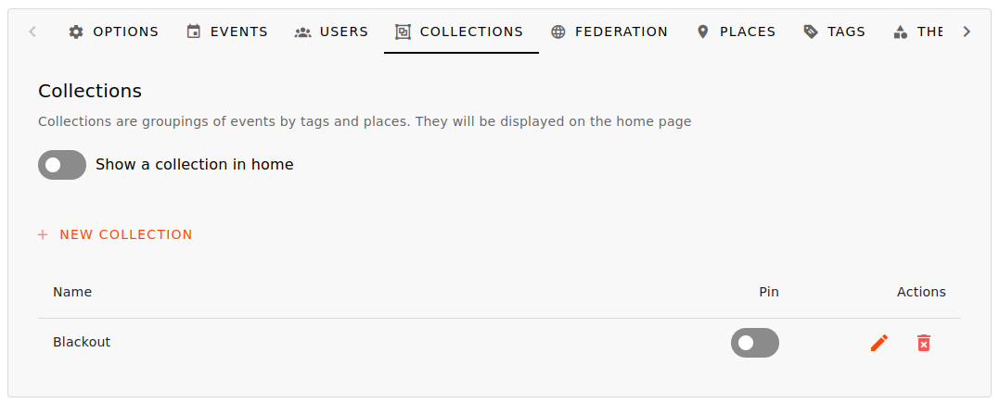

# Collections

Collections are groupings of events filtered by tags, places or federated instances.  

## Creating Collections

There is a specific section in the administration panel called "Collections" where you can create new collections and manage existing ones.

To create a collection choose a wise name and simply select the characteristics of the events you want to include in that collection.  
The selectable characteristics are tags, locations, and federated instances.

You can add multiple filters and for each filter, all selected characteristics will be considered inclusive (e.g. selecting multiple tags will include all events that contain **at least** one of the selected tags).

If you add additional filters with other characteristics, these will be considered exclusive (selecting a tag in a second filter will include all events that pass through the first filter **and also have** this second tag).

For each filter you can specify a **NOT** flag to exclude that selection.

The idea is to first select the most generic filters and then the more specific ones (adding filters will remove events).

It is easier to explain with examples and use cases.

## Use cases

### Grouping events by "organizer"
In Turin (Italy), we have a self-managed radio station ([Radio Blackout](https://radioblackout.org)) that hosts some events at its headquarters, but some benefit events for the radio station are hosted by other venues.
Given the need to group together the radio station's benefit events (regardless of location), it is possible to create a collection for this purpose specifying a filters, with a place "Radio Blackout" and all tags related to the radio station's benefit events (e.g. "blackout", "radio blackout", "benefit radio").
This will include all events hosted at "Radio Blackout" (regardless of tags) and also all the events matching one of the specified tags (regardless the place).

### Grouping events incoming from the federation thematically
Given the international situation, what better opportunity to create an anti-militarist node that collects related events?
This can be done by following trusted sources and selecting events with relevant tags (e.g., Gaza, Ukraine, genocide, war).
Obviously, it would be important to agree on which tags to use, so in this case I suggest a classic #noarmy.

### Grouping events by location
Some nodes relate to a specific geographical area large enough to group events by portions of that area:
the Tuscan node, for example ([lapunta.org](https://lapunta.org)), collects events from an entire region, so in order to display specific cities, they decided to create collections for the most important one (Florence, Livorno, Pisa, Empoli).
To achieve this, you can agree on conventional tags or, as new places are added, associate them with their respective collections.

## Use collection

### Page
Each collection has a specific page where the events that are part of it will be shown.

These pages may or may not be displayed in a dedicated navigation bar on the home page (via the **pin** flag in the administration panel).

The link to the collection page will be `https://<URL>/collection/<collection name>`: for example, the page for Radio Blackout's benefit events collection is 
[https://gancio.cisti.org/collection/Blackout](https://gancio.cisti.org/collection/Blackout), while the page for events in Florence is [https://lapunta.org/collection/Firenze](https://lapunta.org/collection/Firenze).

It is also possible to set a collection as the home page, as is the case with [https://noarmy.gancio.org](https://noarmy.gancio.org).

### RSS, ICS and JSON Feed
Each collection also expose its own RSS feed, ICS feed, and JSON feed!

The feed link are in the format `https://<URL>/feed/<format>/collection/<collection name>` (where format can be `rss`, `ics`, or `json`).  
These links are also specified in the HTML headers of the relevant web pages using the link rel alternate format (e.g. `<link rel="alternate" type="application/rss+xml" title="Gancio - Blackout" href="https://gancio.cisti.org/feed/rss/collection/Blackout">`). 
Note that some RSS feed readers automatically search for this link.  

You are redirected to the respective feed formats when the collection web pages are reached with `Accept` headers set to the respective formats,
i.e. `application/xml` or `application/rss+xml` for RSS. In this case too, some feed and calendar readers use this method to access the respective formats.  

### Widget / WebComponent

It is possible to integrate a small web component into an external website that displays events from a specific collection.

<!--Here, for example, is the list of upcoming events from the noarmy collection!-->

<!---->
<!--<gancio-events sidebar='true' title='No Army' collection='noarmy' theme='light' maxlength=4 baseurl='https://noarmy.gancio.org'><a href='https://noarmy.gancio.org'>no army</a></gancio-events>  -->