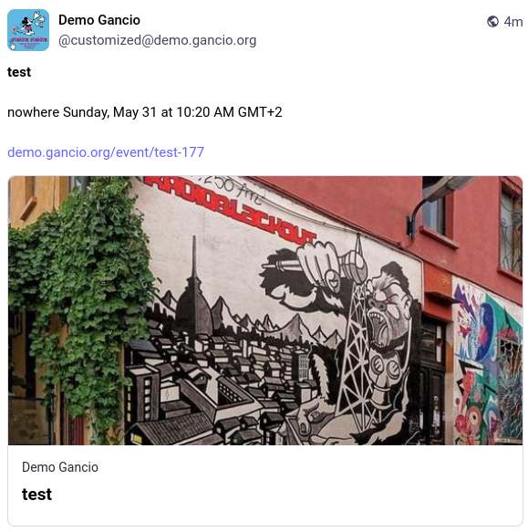
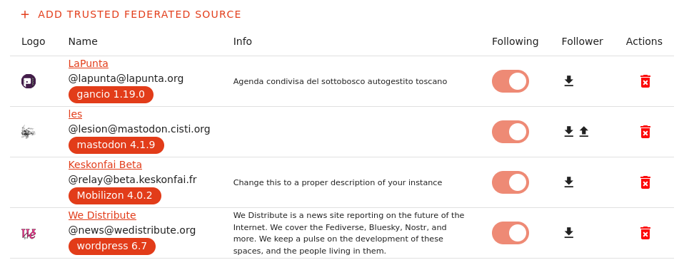

# Federation

Gancio is a federated application. This means that it can interact with other federated applications, such as Mastodon, Pleroma, Friendica, WordPress, Mobilizon, etc.

Each platform instance (server) can interact with others, enabling users to follow content accross different services without needing an account on each one.

This interaction is possible thanks to the [ActivityPub](https://www.w3.org/TR/activitypub/) protocol.

Each user, page, or website in the Fediverse has a unique ActivityPub handler, which is similar to an email address. This handler usually looks like @user@website.com. For example, an event website running Gancio might have an ActivityPub handler like @events@gancio.cisti.org. This identifier lets people from other Fediverse platforms follow it.

::: tip Note
This document describes the operations you are able to do interacting with a gancio instance in the federation, if you are looking for technical details there is a [specific section](/dev/federation)
:::

## Following a Gancio website from the Fediverse

Each federated Gancio instance exposes a single ActivityPub handler, which is the identifier people will use to follow it. This handler consists of the domain where the instance is hosted, with the default prefix being `events` (starting from version 1.24, was `relay` before). The prefix can be customized during the setup but cannot be changed afterward.

To find this handler you can:

- look in the website footer, if the federation is enabled a `Followe me` link will be displayed, it will show the current handler.
- search for the website on your platform

Once followed, new events from that specific Gancio instance will appear in your timeline or event feed (no manual approval is required).

### Following a Gancio website from Mastodon
To follow a Gancio website from Mastodon, you simply need to search for the website and follow it from there (you can specify the handler to follow if you know it or directly use the URL of the website):

<figure><video src='/assets/videos/follow_from_mastodon.webm' controls><figcaption>Follow from Mastodon</figcaption></video></figure>

### Following a Gancio website from Mobilizon
[Mobilizon](https://mobilizon.org/) is a tool designed to create platforms for managing communities and events. Its purpose is to help as many people as possible to free themselves from Facebook groups and events, from Meetup, etc.

To follow a Gancio instance from Mobilizon you can look at their documentation [here](https://docs.mobilizon.org/2.%20Instance%20administration/federation/).

## Following a trusted source from Gancio

Gancio allows you to follow other federated platforms, such as another Gancio node, Mobilizon, WordPress, etc.

Following a fediverse actor lets you receive events from that source, which will appear on your home feed by default unless configured otherwise.
(**Admin > Federation > Show federated events on the home page**)

::: tip Info
You might wonder why it's possible to follow a Mastodon instance from Gancio. The source platform is not restricted, even if it doesn't natively support events. In the case of Mastodon, however, `boosted` events will be shown!
:::

To show only some events incoming from the fediverse you can organize them into collections (**Admin > Collections**) based on tags, federated nodes or specific locations (see [Collections](./collection)).

As you can also add the local instance into one of these collections (and filter its events by Tag or Place), you could, for example, build a collection that consists of some (or all) local events, plus some (or all) events from other (federated) instances.
Collections can be displayed directly on the homepage or on dedicated pages.

## Interacting with Events

Gancio supports federated interaction with events.

Anyone could quote or reply to events with comments, images, or audio. These interactions will appear on the event page (if the option is enabled in **Admin > Federation > Turn on resources**).

Anyone from the fediverse could "Likes" and "Boosts" events, the admin could decide to show them or not in **Admin > Federation > Hide boost/bookmarks**

## Moderation in federation

Gancio provides tools for managing unwanted content coming from the Fediverse in **Admin > Moderation**

- You can moderate comments and content from specific users or federated instances.
- If necessary, you can block entire instances or fediverse actors.

## Disable federation
Federation is enabled by default but you can disable it in **Admin > Federation > Turn on federation**.
